# iPhone LiDAR 측면 영상 한 대로 보행 하체 관절각 추정

**Single side-view iPhone LiDAR + RGB → personalized SMPL → knee-angle time series (treadmill gait)**

<p align="center">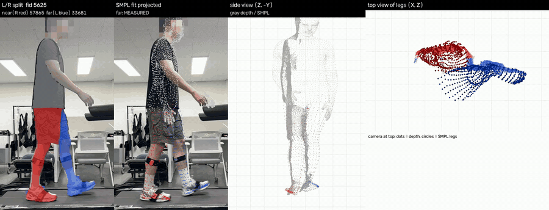</p>

> 개인 프로젝트 (2026.03 – 진행 중) · 촬영, 데이터 수집, 파이프라인 설계·구현·검증 모두 단독 수행
> 재활 로봇 보조 응용을 목표로, 마커 없이 **스마트폰 한 대**로 보행 중 무릎·고관절·발목 각도를 얻는 것이 목표입니다.
> **IMU(Xsens) 대조 검증은 진행 중**입니다. 이 저장소는 결과보다 **과정과 판단 근거**를 정리한 것입니다.

---

## 목차
1. [왜 어려운가](#1-왜-어려운가)
2. [파이프라인 한눈에 보기](#2-파이프라인-한눈에-보기)
3. [단계별 설명](#3-단계별-설명)
4. [문제 해결 사례](#4-문제-해결-사례)
5. [현재 상태](#5-현재-상태)
6. [실행 방법 (Google Colab)](#6-실행-방법-google-colab)
7. [저장소 구조](#7-저장소-구조)
8. [데이터·라이선스](#8-데이터라이선스)

모든 선택지에서 무엇을 시험했고 왜 그것을 골랐는지는 [**docs/DECISIONS.md**](docs/DECISIONS.md) 에 따로 정리했습니다.

---

## 1. 왜 어려운가

| 문제 | 내용 | 이 프로젝트의 대응 |
|---|---|---|
| 카메라 한 대 | 측면에서 찍으면 **반대쪽 다리(far leg)가 주기적으로 가려짐** | 가려진 구간을 판정하고, 측정/보간을 프레임마다 라벨로 구분 |
| LiDAR 품질 | iPhone LiDAR 256×192, 노이즈·프레임 간 깜빡임 | 단안 depth 모델(Sapiens)의 모양 + LiDAR 의 절대 거리를 결합 |
| 학습 기반 3D 자세 | 프레임마다 체형·자세가 출렁임 | 개인 체형은 따로 한 번 측정해 고정, 자세는 depth 측정으로 다시 맞춤 |
| 정답 없음 | 마커 모캡 없음 | Xsens IMU 6개 동시 측정으로 검증 (진행 중) |

## 2. 파이프라인 한눈에 보기

<p align="center">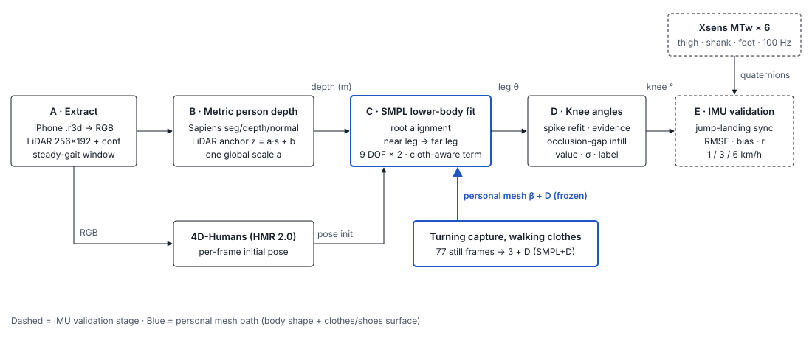</p>

| 단계 | 하는 일 | 코드 |
|---|---|---|
| **0 · 개인 체형** | 정자세 4방향 촬영 → SMPL 체형 β 추정 (한 번, 이후 고정) | [`personalization/`](personalization) |
| **A · 추출** | `.r3d` → RGB / LiDAR depth / confidence, 보행 구간 선택 | NB1 |
| **B · 사람 depth** | Sapiens 상대 depth → LiDAR 로 미터 변환 → 세션 전역 scale 재보정 | NB2, NB3 |
| **C · SMPL 하체 fit** | 4D-Humans 초기 자세 → 몸 위치 정렬 → 가까운 다리 → 먼 다리 | NB4, NB5 |
| **D · 무릎각** | 측정 근거 태깅 → 가려진 구간 보간 → 값·불확실도·라벨 | NB6 |
| **E · IMU 검증** | Xsens MTw 6센서 무릎각과 시간 동기화 후 비교 (진행 중) | NB7 |

## 3. 단계별 설명

### 0 · 개인 체형 (STAND 4방향)

보행 영상에서 매 프레임 체형을 추정하면 프레임마다 다리 길이가 달라집니다. 그래서 **정자세 4방향(앞·오른쪽·뒤·왼쪽)을 따로 촬영**해 체형 β 를 한 번 정하고, 보행 분석 내내 고정합니다.

<p align="center">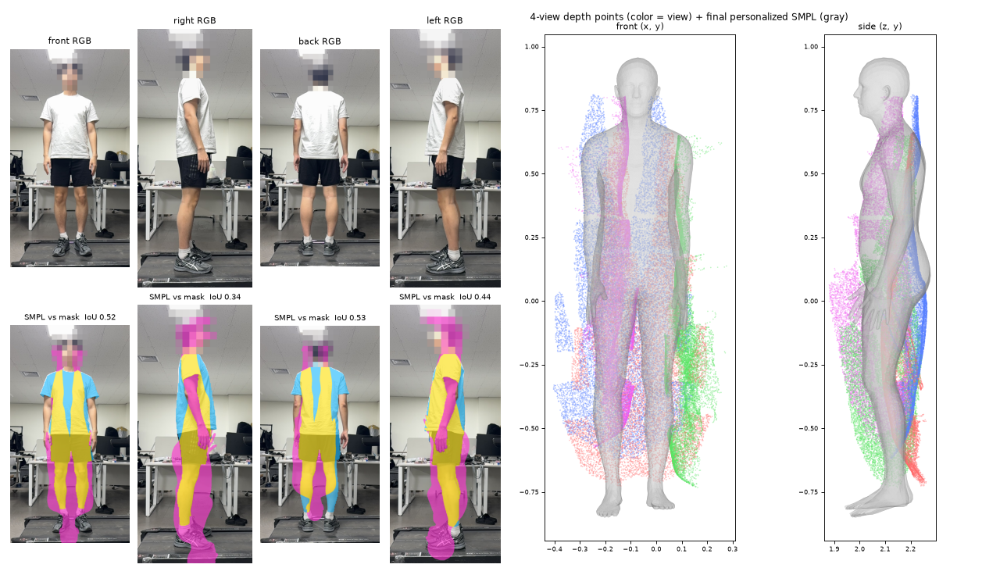</p>

- **II-8 초기화** → **II-10 4방향 공동 fit** (β 는 4방향이 공유, 자세는 방향별. 키 1.81 m 로 β 사전 보정 후 4단계 fit) → **II-12 canonical 정렬** (회전한 사람을 한 좌표계로) → **II-13 단일 정제** (β 고정, 하체 raw depth 잔차 추가)
- 실루엣 IoU 를 따로 재 보니 **왼쪽 뷰만 0.003 으로 붕괴** → 체형이 아니라 왼쪽 뷰 회전 정렬 문제로 진단 → 보정 후 0.41
- 최종 (II-13 보고서): 정자세 메쉬 키 1.808 m (실측 1.81 m), depth 점→메쉬 3.4 cm, 몸통·다리 IoU 0.455
- 한계 (그림 오른쪽): 4방향 depth 점과 메쉬가 아직 어긋나는 곳이 있음. 다리 길이 오차가 무릎각 오차로 이어지는지는 따로 확인 ([4-4](#4-4-다리-길이가-틀려서-무릎이-굽나))

### A · 추출

<p align="center">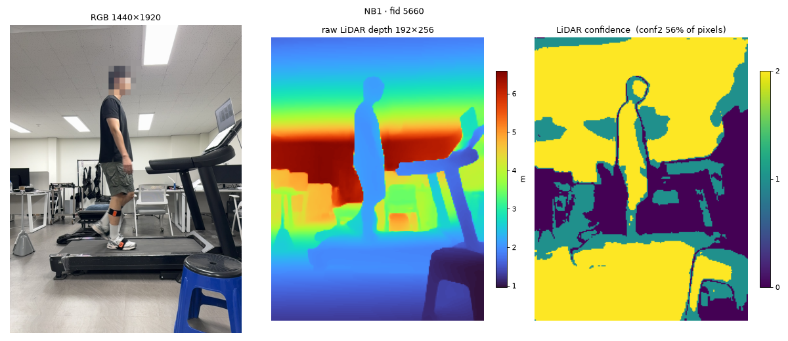</p>

Record3D `.r3d` (zip) 에서 프레임별 RGB 1440×1920, LiDAR 192×256, confidence 를 꺼냅니다. 60 fps 영상은 프레임 기준 파라미터가 30 fps 에서 검증됐기 때문에 2 프레임마다 1장(STEP = 2)으로 맞춥니다.

### B · 사람 depth (Sapiens + LiDAR)

<p align="center">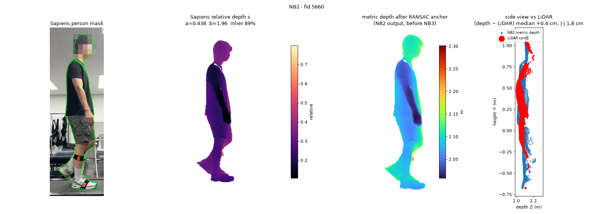</p>

- Sapiens 1B 로 사람 마스크·상대 depth `s`·normal 을 구하고, LiDAR 고신뢰 점으로 `z = a·s + b` 를 RANSAC + MAD 로 맞춥니다.
- 프레임마다 `a` 를 따로 맞추면 `a` 가 0.2 ~ 0.8 로 출렁이고, 그만큼 **몸통 두께가 프레임마다 압축·팽창**합니다 (상관 r = 0.867). 그래서 세션 전체에서 `a` 하나를 정해 다시 적용합니다.

<p align="center">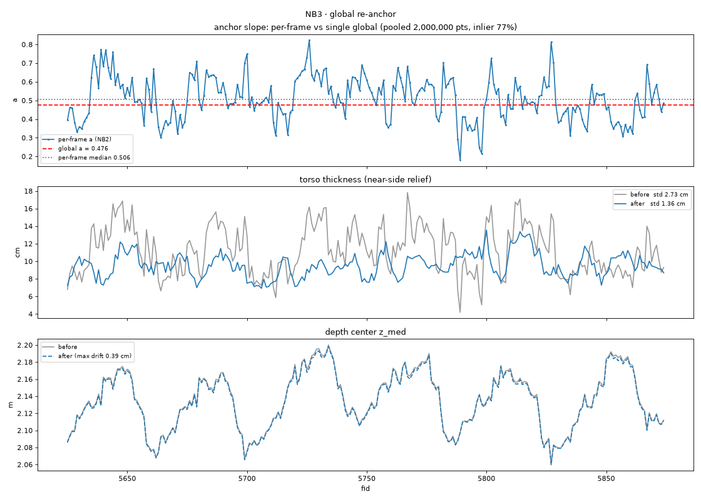</p>

전역 `a` 재적용 후 몸통 두께 std 2.73 → 1.36 cm, 사람까지 거리는 최대 0.39 cm 만 변함 (7/29, 3 km/h). 전역 `a` 를 구하는 방식 자체에서 생긴 문제는 [4-1](#4-1-전역-scale-a-가-치우친-이유-심슨-역설).

### C · SMPL 하체 fit

<p align="center">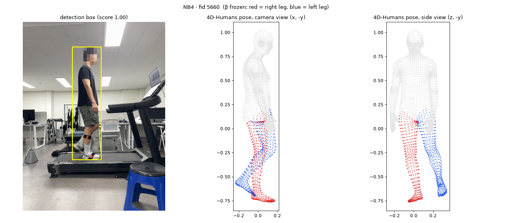</p>

1. **4D-Humans (HMR 2.0)** 로 프레임별 초기 자세. β 는 0 단계 값으로 교체.
2. **A0 몸 정렬**: 몸 전체 위치·방향만 depth 에 맞춤 (몸통 가중 1.0, 다리 0.3).
3. **좌우 다리 구분**: 측면 촬영이라 카메라 거리 z 가 곧 사람의 좌우 축. 하체 점의 z 를 1D 2-means 로 나누고, 두 무리 간격이 8 cm(다리 두께) 미만이면 "겹침"으로 보고 나누지 않음.
4. **가까운 다리 → 먼 다리** 순서로 각각 고관절·무릎·발목 9-DOF 를 depth 표면에 맞춤 (Huber 3 cm, 카메라에서 보이는 면만, **자세 prior 없이 측정만으로**).

<p align="center">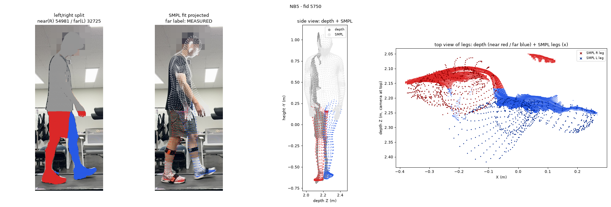</p>

### D · 무릎각 시계열

<p align="center">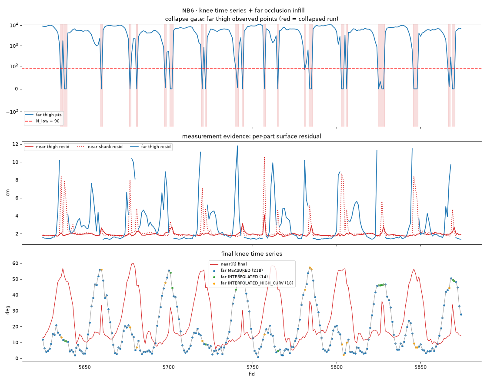</p>

- 먼 허벅지의 관측 점 수가 기준(N_low) 아래로 떨어지는 구간 = **가려짐** (위 그래프의 빨간 띠).
- 짧은 가림은 앞뒤 측정값으로 보간하고, 정점이 가림 안에 갇히는 경우는 `INTERPOLATED_HIGH_CURV` 로 따로 표시.
- 모든 프레임에 **값 · 라벨(MEASURED / INTERPOLATED / INTERPOLATED_HIGH_CURV) · 보간 불확실도 σ** 를 같이 저장. 7/29 3 km/h 250 프레임: MEASURED 218 / INTERPOLATED 14 / HIGH_CURV 18.

<p align="center">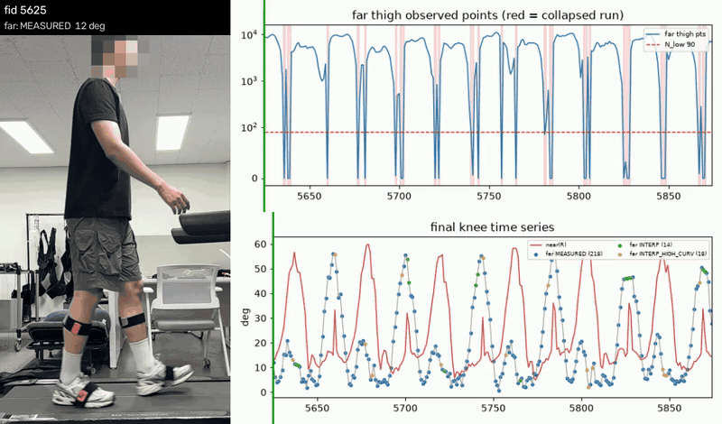</p>

### E · IMU 검증 (진행 중)

- Xsens MTw Awinda 6개 (양쪽 허벅지·정강이·발, 100 Hz). 정지 기립 2 초로 센서 → 분절 장축을 캘리브레이션해 SMPL 과 같은 정의의 무릎각을 계산.
- 시간 동기화: 영상·IMU 활동량 상호상관 (평활 창 1/2/4 s 로 강건성 확인) + **점프 착지 순간** 앵커 + 무릎각 곡선 미세 정렬.

## 4. 문제 해결 사례

### 4-1. 전역 scale `a` 가 치우친 이유: 심슨 역설

<p align="center">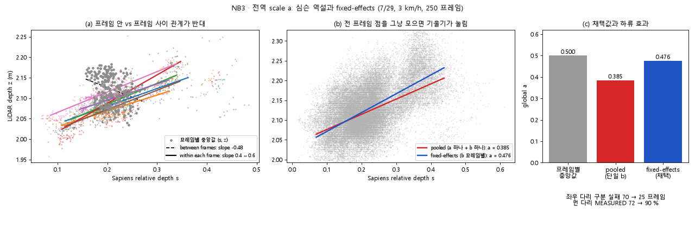</p>

전 프레임의 (s, z) 점을 그냥 모아 `a` 하나, `b` 하나로 맞추니 `a` = 0.385 로, 프레임별 값의 중앙값(0.50)보다 한참 낮았습니다. 보행 중 사람이 카메라 쪽으로 오가며 **프레임마다 b(거리)가 다른데**, 그 차이가 프레임 사이에서 반대 방향의 기울기를 만들어 전체 기울기를 끌어내린 것입니다.
→ **a 공통 + b 프레임별 (fixed-effects)** 로 바꿔 `a` = 0.476. 그 결과 좌우 다리 구분 실패 70 → 25 프레임, 먼 다리 MEASURED 72 → 90%.

### 4-2. 자세 prior 를 없앤 이유 (λ = 0)

자세 prior 세기 0.02 / 0.002 / 0 을 비교하고, 잔차·각도 폭주·jitter·저관측 프레임 네 가지 안전 기준을 걸었습니다. prior 없이도 네 기준을 모두 통과해 (1주기 42 프레임, 발산 0, 잔차 median 1.52 → 1.43 cm) **측정 주도**로 통일했습니다.

### 4-3. 보간 버그를 인위 가림 실험으로 잡기

먼 다리 보간에서 Hermite 끝점 기울기를 창 중앙 기울기로 잘못 쓰고 있었습니다. 정답이 있는 **가까운 다리를 일부러 가리는 실험**으로 편향을 재니 +1.24° (정점이 경계일 때 +2.34°). 2차 fit 끝점 미분으로 고친 뒤 +0.40°, "정점이 가림 안에 갇힘" 판정은 4건 → 2건 (절반이 버그가 만든 허상).

### 4-4. 다리 길이가 틀려서 무릎이 굽나?

다리를 거의 편 디딤기 구간에서 무릎각이 IMU 보다 크게 나와, "개인 체형의 다리가 길어서 무릎을 굽혀 맞추는 것"이라는 가설을 세웠습니다. 디딤기 148 프레임에서 SMPL 발바닥과 depth 발바닥 높이를 비교하니 SMPL 발이 오히려 **2.5 cm 위**(신발 밑창 두께)였고, 높이 차와 편향의 상관은 −0.08. 또 무릎을 2° → 8° 굽혀도 고관절~발목 거리는 2 mm 밖에 줄지 않아, cm 단위 길이 오차로는 몇 도의 편향을 설명할 수 없습니다 → **가설 기각**. 남은 후보는 정강이 표면 기울기(바지·종아리 모양)와 4D-Humans 초기값의 과굴곡이고, 확인 실험을 준비 중입니다.

### 4-5. 깊이 모델 고르기

Depth Pro, PromptDA, Depth Anything v2, Prior-Depth-Anything, Sapiens 를 정자세 4방향에서 키(실측 1.81 m)와 시간축 깜빡임으로 비교했습니다. PromptDA 계열은 키 1.86 – 2.23 m 로 과대, DAv2 는 키 jump std 0.99 cm (기준 0.5 cm 초과) → Sapiens + LiDAR 채택. 자세한 표는 [DECISIONS.md D3](docs/DECISIONS.md).

## 5. 현재 상태

- [x] 0 · 개인 체형 (STAND 4방향)
- [x] A ~ D 파이프라인, Google Colab 으로 이식 (연구실 PC 없이 전 과정 재실행)
- [x] 2026-07-29 데이터 수집: iPhone 영상 + Xsens MTw 6센서, 트레드밀 1 / 3 / 6 km/h
- [x] IMU 무릎각 계산·동기화 모듈
- [ ] **IMU 대비 무릎각 정확도 (RMSE / bias / 상관)** ← 진행 중
- [ ] 무릎각 → 관절 회전 정리, OpenSim IK 연결

> 이 저장소의 수치는 피험자 1명(본인) 데이터입니다. IMU 결과가 나오기 전까지 "정확도 몇 도"는 주장하지 않습니다.

## 6. 실행 방법 (Google Colab)

1. 이 저장소를 Google Drive `MyDrive/walking_0729/` 로 복사 (`pipeline/scripts`, `pipeline/notebooks` → `scripts/`, `notebooks/`).
2. `assets/` 에 **직접 받은** SMPL 모델과 체형 파일을 둡니다 (아래 [데이터·라이선스](#8-데이터라이선스)).
3. `raw/` 에 Record3D `.r3d`, (선택) Xsens 내보내기 `.txt` 를 둡니다.
4. **`NB_RUN_ALL.ipynb`** 하나로 NB1 → NB7 을 순서대로 실행하거나, NB1 ~ NB7 을 하나씩 실행합니다. GPU 런타임 (T4 이상) 필요.

```
MyDrive/walking_0729/
├── assets/     models/smpl/SMPL_NEUTRAL.pkl, final_single_smpl_params.npz (β), smpl_vert_segmentation.json
├── raw/        *.r3d, imu/*.txt
├── scripts/    ← pipeline/scripts
├── notebooks/  ← pipeline/notebooks
└── sessions/   (자동 생성) {SESSION}/00_extract … 06_imu, viz/
```

개인 체형 단계는 [`personalization/README.md`](personalization/README.md) 참고.

## 7. 저장소 구조

```
├── personalization/          0 · 개인 체형 (STAND 4방향 → β)
│   ├── notebooks/            S1 Sapiens depth, S2 4D-Humans 초기값 (Colab)
│   ├── smpl_pipeline/        ii8 → ii10 → ii12 → ii13 (+ 진단 ii14 – ii17)
│   └── config/               왼쪽 뷰 보정값
├── pipeline/
│   ├── notebooks/            NB0 – NB8, NB_RUN_ALL (Colab)
│   └── scripts/              walkcfg.py (경로 설정) + 단계별 스크립트 + 시각화
└── docs/
    ├── DECISIONS.md          선택지별 근거 기록
    ├── figures/, media/      README 그림 (얼굴 모자이크 처리)
```

## 8. 데이터·라이선스

- **포함하지 않은 것**: SMPL 모델 파일 (재배포 금지 — [smpl.is.tue.mpg.de](https://smpl.is.tue.mpg.de) 에서 직접 받아야 함), 원본 영상·depth·IMU 데이터, 개인 체형 β 파일.
- 그림·영상의 얼굴은 모두 모자이크 처리했습니다.
- 사용한 외부 모델: [Sapiens](https://github.com/facebookresearch/sapiens) (CC BY-NC 4.0), [4D-Humans](https://github.com/shubham-goel/4D-Humans) (MIT), [detectron2](https://github.com/facebookresearch/detectron2) (Apache 2.0), [SMPL](https://smpl.is.tue.mpg.de) (연구용 라이선스). 각 라이선스를 따릅니다.
- 이 저장소의 코드: [MIT](LICENSE).

## 기술 스택

Python · PyTorch · NumPy / SciPy · OpenCV · SMPL / smplx · Meta Sapiens (Seg / Depth / Normal 1B) · 4D-Humans (HMR 2.0) · detectron2 · Open3D · Record3D (iPhone LiDAR) · Xsens MTw Awinda · Google Colab · RANSAC / robust 통계 · 최적화 기반 모델 피팅
