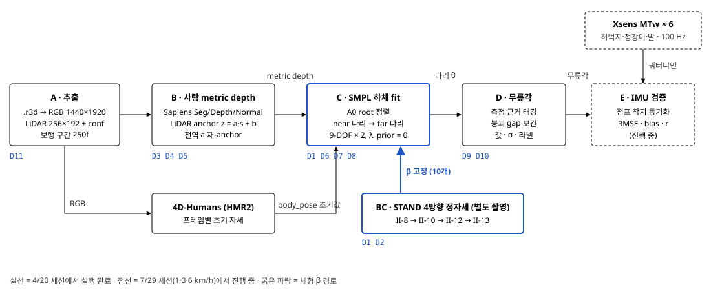

# walking_r3d 결정 기록

파이프라인의 각 선택 지점에서 어떤 후보를 시험했고, 무엇을 근거로 하나를 골랐는지 정리한 기록입니다. 수치는 모두 실험 기록 원본(EXPERIMENTS.md, Gate 판정 문서, 결과 json/npz)에서 옮겼고, 원본에 근거가 없는 결정은 따로 표시했습니다.
수치 기준: 2026-04-20 보행 세션 · 30fps · 분석 200프레임 · 다리 fit λ = 0.01 / 0.02 버전 IMU 대조 검증: 진행 중 파랑 = 채택 점선 = 근거 문서 없음

> **2026-10 업데이트 (이 문서 작성 이후 바뀐 것)**
> - **D5 전역 a 추정 방식 변경:** 전 프레임 점을 그대로 모아 `a` 하나 + `b` 하나로 맞추던 방식이, 프레임마다 사람까지 거리(b)가 다른데 그 차이를 기울기로 흡수해 a를 낮게 치우치게 함(7/29 3 km/h: 0.385 vs 프레임별 중앙값 0.50, 심슨 역설). → **fixed-effects (a 공통 + 프레임별 b)** 로 변경, a = 0.476. 좌우 다리 구분 실패 70 → 25 프레임, far MEASURED 72 → 90%. ([그림](figures/fe_global_a.png))
> - **좌우 다리 구분 v2.3:** 하체 점 z 1D 2-means, 분리 8 cm 미만이면 "겹침"으로 보고 전부 near 처리.
> - **IMU 동기화:** 점프 착지 앵커 + 활동 envelope 상관(평활 창 1/2/4 s 강건성) + 무릎각 곡선 미세정렬. 점프가 없는 세션은 탐색 창을 보행주기의 0.3 으로 제한.
> - **60 fps 영상:** 프레임 기준 파라미터가 30 fps 에서 검증됐으므로 STEP = 2 로 30 fps 로 맞춤.
> - **개인 메쉬·옷 처리·튐 재피팅 (D2 개정, D12, D13):** [DECISIONS_2026-10_personal_mesh.md](DECISIONS_2026-10_personal_mesh.md) — 이전 STAND 피팅이 거꾸로 선 채였던 버그, SMPL+D 개인 메쉬, 옷 처리 후보 비교, 튄 프레임 재피팅.

## 전체 구조도
 

*보행 영상 한 개에서 나오는 흐름(A→E)과, 따로 찍은 STAND 정자세에서 만든 개인 체형 β가 C 단계로 고정 주입되는 구조입니다. D 번호는 아래 결정 기록과 연결됩니다.*

## 결정 기록

각 결정은 질문 → 채택 → 후보별 결과 → 이유 순서입니다. 파라미터는 값마다 근거가 실험인지, 물리·문헌인지, 근거 문서가 없는지 표시했습니다.
### D1 · 인체 모델

관절각을 뽑을 몸 모델로 무엇을 쓸 것인가.
**채택: SMPL (neutral, β 10개)** · 경로 B 우선 전략. SMPL로 끝까지 완성하고 IMU 비교 뒤 SKEL 전환 여부를 정한다.

| 후보 | 결과 (측정) | 판정 |
|---|---|---|
| SMPL | 어깨 커버율 90–93%, 어깨/골반 비율 1.29 · 4D-Humans 초기값을 그대로 씀 · 기존 SMPL 인프라 100% 재사용 | 채택 |
| SKEL (생체역학 골격) | SMPL→SKEL 변환 RMS 6.96 mm, 정강이 chamfer 20.6 mm (정강이는 SKEL이 더 정밀: 커버 82–84% vs 67–69%) · 어깨 betas 한계로 잔차 17 mm, 어깨 커버 39–40%, 어깨/골반 비율 < 1.0 | 보류 |
| SMPL-X | "SMPL-X 안 씀" 기록만 있음 | 근거 문서 없음 |

- SMPL은 4D-Humans 출력 공간과 같아서 초기 자세를 변환 없이 받을 수 있고, 진입 비용이 가장 낮았다.
- SKEL은 정강이 정합은 좋았지만 어깨 체형을 betas로 표현하지 못해 상체 정합이 무너졌다.
- 알고 택한 단점: SMPL 무릎은 3-DOF라 hinge 제약이 없다. D9에서 hinge 지배도 0.787로 실측해 1-DOF 가정이 유효함을 확인했다.

출처: Walking_stand/README.md §3 · [Result]Gate1/GATE1_RESULT.md · [Result]Gate4_smpl_fullbody/SMPL_DISP_RESULT.md
### D2 · 개인 체형 β를 어디서 얻을 것인가

보행 프레임마다 체형을 추정할지, 한 번 정해서 고정할지.
**채택: 별도 STAND 4방향 촬영에서 β를 한 번 구해 보행 전체에 고정.** β는 II-10 4뷰 공동 fit에서 정해졌고, 이후 refine은 자세·위치만 조정(β 학습률 0).

| 후보 | 결과 | 판정 |
|---|---|---|
| 프레임별 HMR β | 프레임마다 출렁임 → 4D-Humans 노트북에서 진단용으로만 저장 | 기각 |
| T-pose 1단계 체형 fit | 합격 기준 MPJPE < 3 cm 미달: 최저 3.01 cm(β 8/10 clamp), sweep 32조합 최상 3.50 cm · 어깨폭 −4.5 cm, 골반폭 −2.6 cm | FAIL |
| STAND 4뷰 (II-10 → II-13) | 최종 키 1.8076 m (실측 1.81) · 점→메쉬 3.4 cm · 몸통·다리 IoU 0.455 | 채택 |

| II-13 단계 | 4뷰 target 평균 | 하체 z 평균 | 점→메쉬 | 몸통·다리 IoU |
|---|---|---|---|---|
| yaw-only | 0.132 m | 0.153 m | 0.055 m | 0.332 |
| + raw depth 잔차 loss | 0.133 m | 0.118 m | 0.055 m | 0.336 |
| + 왼쪽 뷰 보정 (최종) | 0.087 m | 0.111 m | 0.034 m | 0.455 |

- raw depth 잔차를 넣자 하체 z가 좋아졌지만, 실루엣 IoU를 재보니 왼쪽 뷰만 0.0035로 붕괴. 체형 문제가 아니라 왼쪽 뷰 회전 정렬 문제로 진단했다.
- 왼쪽 뷰 보정(yaw +10°, x −0.25 m, y −0.08 m) 후 왼쪽 IoU 0.0035 → 0.411, 하체 z 샘플 0 → 1359.
- 근거 문서 없음 보정값을 찾은 탐색 과정은 기록이 없다. 원본은 "empirical, 물리적 의미 아님, x/pivot 정렬이 진짜 원인일 가능성"이라고 적고 있다.

출처: BC_stand_smpl_fit/EXPERIMENTS.md · outputs/ii13_single_refine_rawdepth_w05_leftcorr/final_refine_report.json · ii17 silhouette json · Tpose/[Script]02_smpl/[Stage1] sweep summary.md
### D3 · 사람 깊이(depth) 소스

해상도 낮고 노이즈 큰 LiDAR를 무엇으로 보강할 것인가.
**채택: Sapiens Depth 1B (상대 깊이) + LiDAR 고신뢰 점으로 metric 변환.**

| 후보 | STAND 4뷰 키 (실측 1.81 m) | 다른 지표 | 판정 |
|---|---|---|---|
| raw LiDAR | 2.10 – 2.40 m | 256×192, 키 과대 | 단독 불가 |
| Depth Pro | 1.86 – 1.95 m | 뷰 간 scale 변동 CV 0.238 (scale 0.69–1.39) | 기각 |
| PromptDA (+prior 변형) | 1.86 – 2.23 m | CV 0.060–0.064 · 얼굴 왜곡, fp32 풀해상도 OOM | 기각 |
| Depth Anything v2 | 1.757 – 1.828 m | 시간축 키 jump std 0.99 cm > 기준 0.5 cm → FAIL | 기각 |
| LiDAR + Depth Pro 융합 (0310) | — | 분절 길이 변동 8.30 (2D only 2.87, 비교군 중 최악) | 기각 |
| Sapiens + LiDAR anchor | 평균 1.777 m (재-anchor 전) | 키 std 1.56 cm → 재-anchor 후 1.44 cm | 채택 |

- 다른 단안 모델은 키가 과대하거나(PromptDA), 뷰마다 scale이 흔들리거나(Depth Pro), 프레임 간 깜빡임 기준을 넘었다(DAv2).
- Sapiens는 사람 전용 모델이라 몸 표면 형태가 안정적이고, 절대 스케일은 LiDAR가 맡는 역할 분담이 가능했다.
- 근거 문서 없음 Sapiens와 DAv2를 같은 지표로 직접 비교한 수치는 없다(지표 정의가 서로 다름). LiDAR를 심판으로 쓴 교차검증(compare_belt_vs_sapiens)은 결과 파일이 원본 작업 폴더에만 남아 있다.

출처: Walking_stand/promptda_gate/out_full/compare5way/summary.json · Walking/DAv2_50frames…/flicker_report.json · 0310/depth_pipeline/fused_output/segment_cv_comparison.json · B_depth_pipeline/EXPERIMENTS.md
### D4 · 상대 깊이를 미터로 바꾸는 방식

Sapiens 출력 s를 실제 거리 z로 어떻게 맞출 것인가.
**채택: 사람 마스크 안 LiDAR 점으로 z = a·s + b 직선 적합, RANSAC + MAD.**

| 파라미터 | 값 | 이유 | 근거 |
|---|---|---|---|
| 적합 방식 | RANSAC + MAD | iPhone LiDAR 정합에서 polyfit보다 robust (F +8–10%) | 문헌 PromptDA C.5 |
| 사용 점 | conf == 2 | LiDAR 신뢰도 최상 점만. 부족하면 conf ≥ 1로 완화, 50점 미만 프레임은 건너뜀 | 설계 |
| 최소 점 수 | 300 | 이보다 적으면 a, b 불안정 경고 | 근거 문서 없음 |
| 모드 | depth 고정 | Sapiens 출력은 전 프레임 depth형(재적합 a≈1, 양수)이라 disparity 분기를 막아 모드 전환 떨림 제거 | 실측 |
| crop 상자 | 전 프레임 고정 (p5/p95) | 마스크 떨림 → 상자 떨림 → crop 이동 → 상대 깊이 깜빡임 연쇄를 원천 차단. 트레드밀 제자리 보행이라 가능 | 설계 |

출처: extract_pool_fit.py docstring · NB2(person_depth_pipeline_VIDEO_v3) anchor_auto / 5.5 셀
### D5 · 프레임 간 깊이 깜빡임 처리

시간축으로 평활할 것인가, 원인을 제거할 것인가.
**채택: 평활하지 않음. 대신 프레임별 기울기 a를 전 프레임 공통값 하나(global a = 0.486)로 다시 맞춤.**

| ① 깊이 중심(z_med)은 평활이 필요한가 |  |
|---|---|
| 관측 변동 median | 0.61 cm |
| anchor 자체 불확실성 하한 | 2.44 cm |
| 변동 구성 | 보행 72% · 깜빡임 26% · drift 1% |
| 판정 | 평활 불필요. 평활하면 실제 보행 신호를 지운다 |

| ② 몸통 두께는 왜 흔들리나 |  |
|---|---|
| 몸통 두께 범위 | 2.7 – 18.7 cm |
| corr(두께, 프레임별 a) | 0.867 |
| 압축 프레임 | 125 / 250 |
| 판정 | a 흔들림이 만든 가짜 변동 (ANCHOR_ARTIFACT) |

| global a 후보 | 구한 방법 | 판정 |
|---|---|---|
| 1.099 | SMPL 몸통 core 폭 / 보행 s 범위 core | 참고 관측 영역·목표가 다름 |
| 0.817 | T-pose SMPL 몸통 near-side 두께 18.8 cm / s 범위 | 참고 독립 교차검증용 |
| 0.486 | 전 프레임 LiDAR 점 pool → RANSAC + MAD 한 번 | 채택 RadarCam-Depth "Const" 방식 |

- 직선 z = a·s + b는 중심점을 지나므로, a를 바꿔도 위치(z_med)는 그대로이고 두께만 a에 비례한다. 그래서 a 하나만 통일하면 위치 안정성은 지키고 두께 흔들림만 없앤다.
- 원본 s_relative를 다시 쓰므로 이미 metric으로 바꾼 깊이를 늘리는 방식보다 노이즈가 증폭되지 않는다.
- 결과: 몸통 두께 std 1.69 cm, 키 std 1.44 cm. 이 두 값이 이후 A0의 GATE3 기준이 됐다.
- 후속 점검: GATE3에서 남은 흔들림을 scale로 다시 보정해 보니 std가 오히려 39% 늘었다 → 남은 변동은 실제 몸통 회전으로 판정하고 그대로 진행.
- 근거 문서 없음 tail 제거(GRAZE 75°, DISC 0.03, ERODE 2px)와 Poisson refine(λ 0.1, 800회)은 "검증 노트북 값 그대로, 변경 금지"로만 기록돼 있다.

출처: B_depth_pipeline/EXPERIMENTS.md §1–4 · C_smpl_pose_fit/EXPERIMENTS.md §1–2, §7–8 · phase4_reanchor.py docstring
### D6 · A0 · 몸 전체 위치·방향 정렬

다리를 맞추기 전에 몸통을 깊이에 어떻게 고정할 것인가.
**채택: root(global_orient, transl)만 최적화. β는 STAND 값, 자세는 4D-Humans 값으로 고정. 카메라 쪽 다리 + 상체 점만 사용.**

| 파라미터 | 값 | 이유 | 근거 |
|---|---|---|---|
| 데이터항 점 | near 다리 + 상체 | far 다리 점이 near 다리로 새는 것을 막기 위함 | 설계 |
| 좌우 다리 분리 | z 2-means, 간격 ≥ 8 cm | 다리 두께 약 8 cm라는 물리값. "분리율 결과에 맞춰 조정 금지" | 물리 |
| far 클러스터 최소 비율 | 15% | 튄 점 배제 | 근거 문서 없음 |
| 보이는 면만 | normal.z < 0 | 카메라를 향한 SMPL 정점만 비교 (PROX 가시 표면 근사) | 문헌 |
| 2D 키포인트 항 | λ_KP2D = 0 | 몸 방향(yaw)은 정·역방향 두 초기값 중 에너지 낮은 쪽 선택 + GATE2로 방어. yaw가 불안정하면 그때 켬 | 설계 |
| near = 오른다리 | 고정 | 카메라가 오른쪽에서 촬영, GATE2 near→right ≈ 1 확인 | 실측 |
| 점 수 상한 | 15,000 | 거리 계산 병목 완화, 실루엣 전체는 유지 (SMPLify/PROX 관례) | 관례 |
| 반복 수 | 100 | 이전 250회 실행이 육안 정합 통과 → 수렴 확인 | 육안 |
| Huber δ | 3 cm, 단방향 | "불변"으로만 기록 | 근거 문서 없음 |
| 몸통/다리 가중치 | 1.0 / 0.3 | v2 변경 "몸통 가중"으로만 기록 | 근거 문서 없음 |

출처: a0_align_v2.py docstring·주석 · C_smpl_pose_fit/README.md Stage 05
### D7 · 다리 fit 순서와 측정 판정

가려지는 반대쪽 다리를 어떻게 다룰 것인가.
**채택: near 다리 9-DOF를 먼저 맞추고, 그 값을 고정한 채 far 다리 9-DOF를 맞춤. far 점이 300개 이상인 프레임만 MEASURED.**

| 파라미터 | 값 | 이유 | 근거 |
|---|---|---|---|
| 순서 | near → far | 잘 보이는 다리부터 확정. far fit 뒤 near 잔차를 다시 재서 far가 near를 건드리지 않는지 검증 | 설계 |
| MEASURED 기준 | far 점 ≥ 300 | 다리 y-band별 z 분리 실측(shin/thigh/knee, 200f)에서 도출 | 실측 |
| far 허벅지 오염 점검 | z 간격 12–14 cm | 8 cm 기준을 넘어 분리 견고. 허벅지를 빼고 재fit해도 무릎각 차 평균 2.05° → 진짜 far 허벅지 | 실측 |
| 다리 y-band 여유 | 위 0.02 / 아래 0.10 m | 발 점이 다리로 넘치는 것 방지. 숫자 자체의 근거는 없음 | 근거 문서 없음 |
| 좌우 라벨 대안 | RTMW3D 오른다리 tube | 비교 데이터만 저장, 판정 안 함 → z 2-means 유지 | 미채택 |

출처: C_smpl_pose_fit/EXPERIMENTS.md §3–6 · B_depth_pipeline/EXPERIMENTS.md §5 · depthfit_*_lam0.py docstring
### D8 · 자세 prior 세기 (λ_prior)

4D-Humans 자세로 당기는 정규화를 얼마나 둘 것인가.
**채택: λ = 0 (양다리 모두 prior 없이 측정 주도).** 원래 near 0.01, far 0.02.

| 1 보행주기 42f (전체 잔차 median) | 잔차 | jitter | ROM | \|Δknee\| median / max | 게이트 |
|---|---|---|---|---|---|
| near λ = 0.02 | 1.52 cm | 1.14° | 53.1° | — | — |
| near λ = 0 | 1.43 cm | 1.32° | 54.2° | 2.97° / 5.72° | 발산 0/42 · 폭주 0/42 |
| far λ = 0.02 | 1.53 cm | 2.51° | 53.6° | — | — |
| far λ = 0 | 1.32 cm | 3.06° | 51.3° | 1.77° / 6.69° | 저관측 11f \|Δ\| 1.73° |

- prior가 주는 이득은 near jitter −0.18°뿐인데, 대가로 각을 4D-Humans 쪽으로 median 2.97° 끌어당긴다. 측정을 덮는 쪽이라 제거.
- jitter 게이트(G3)는 실제로 걸렸지만(1.32 > 1.14), 두 값 모두 4D-Humans 기준선 1.53°보다 낮고 시간 일관성은 별도 단계(A3)가 맡기로 해서 수용.
- far는 이 42f 구간이 잘 보이는 국면이라 당시 보류 → D10에서 가림 구간을 prior 없이 보간으로 해결하면서 양다리 prior-free로 통일.
- 근거 문서 없음 λ = 0.002 케이스는 실행 기록에 수치가 없다.

출처: D_walking_analysis/EXPERIMENTS.md 357–394행 · [Result]09_prior_ablation/prior_ablation_cycle.log
### D9 · 무릎각 정의

SMPL 회전에서 무릎각 숫자 하나를 어떻게 뽑을 것인가.
**채택: 분절각 (허벅지 벡터 hip→knee 와 정강이 벡터 knee→ankle 사이 각, 펴면 0°).** IMU 쪽도 같은 정의로 계산.

| 방법 (200f) | 내용 | ROM | 상호 비교 |
|---|---|---|---|
| A 분절각 | 두 뼈 벡터 사이 각 | 54.3° | corr(A,B) 0.997, RMS 7.16° · corr(B,C) 0.9998, RMS 1.14° |
| B swing-twist | 상대회전의 지배축 투영 (부호 있음) | 60.2° |  |
| C raw axis-angle | body_pose 무릎 x 성분 | — |  |

- hinge 지배도 오른 무릎 0.787, 왼 무릎 0.820 (특이값 6.43 / 1.38 / 0.36) → 무릎 1-DOF hinge 가정이 유효.
- 4D-Humans 무릎각 jitter median 1.53°를 이후 모든 fit 판정의 기준선으로 삼음.
- 분절각은 IMU처럼 두 분절 장축만으로 정의할 수 있어 비교 기준을 맞추기 쉽다.
- 근거 문서 없음 A를 B보다 "선택한" 이유를 명시한 문장은 원본에 없다. A·B의 ROM 6° 차이를 SKEL/OpenSim 쪽 정의와 맞추는 게이트는 미실행.

출처: D_walking_analysis/EXPERIMENTS.md 7–48행 · knee_angle_gate.py · C_smpl_pose_fit/EXPERIMENTS.md §9
### D10 · 가려진 far 다리 구간 채우기

far 허벅지가 안 보이는 프레임의 무릎각을 prior로 메울지, 시간 보간으로 메울지.
**채택: prior 없이 짧은 gap 시간 보간.** 양옆 측정값 차이 Δ로 분기 (Δ < 3° 선형, Δ > 12° cubic, 사이는 보수적으로 정점형), 기울기는 quad4.

- **prior가 필요 없는 이유:** 관측 점 수 분포가 둘로 갈려 붕괴 기준 N_low = 2,839점. 붕괴 run 10개가 전부 2–4프레임이고 양옆이 모두 측정됨 → 최대 gap 4로 두면 시간 보간 10 / prior 0. 이것이 LENGTHS 2–4의 근거.
- **3° / 12° 분기:** 안전한 run은 Δ 0.5–2.2°, 정점을 품은 run은 12.1–20.3°로 완전히 갈림. 실제 모호대 경고 0건.

| 보간 기울기 추정기 (near 인위 가림, far와 같은 조건) | bias | median \|e\| | p95 | 판정 |
|---|---|---|---|---|
| lin3 (기존, 창 중앙 기울기를 끝점에 씀 = 버그) | +1.24° | 1.65° | 2.71° | 버그 |
| quad3 | +1.45° | 1.20° | 3.56° | 3점 정확 보간이라 jitter까지 미분 |
| quad4 (2차 fit 4프레임, 끝점 미분) | +0.40° | 1.09° | 2.64° | 채택 |
| quad5 | +0.75° | 1.68° | 2.91° | 5프레임은 정점 곡률을 못 담음 |

| 기각한 대안 | 시험 결과 | 기각 이유 |
|---|---|---|
| 다른 주기 정점으로 앵커 (cross-cycle) | 다른 주기 정점 median 61.16°, spread 4.86° | 1064 주기는 64.34°를 직접 측정 → 앵커가 측정을 덮음. spread는 실제 걸음 간 변동 |
| bias 보정 (−0.40°) | 1022 프레임 59.13° | 측정 anchor 59.48°보다 낮아져 측정값 위반 |
| Δ 조건부 σ 캘리브레이션 (v2) | 200f RMS 기여 예상 1.51° → 0.93°, 실제 1.42° | σ(Δ)가 단조가 아님(LIN corr 0.16, U자), K=40이 후보 68–89%라 매칭 무의미. 근본 원인: near 독립 주기 ≈ 5개 |

| 최종 200프레임 (λ = 0.02 far fit 기반) | MEASURED | INTERPOLATED | HIGH_CURV |
|---|---|---|---|
| 프레임 수 | 168 (84%) | 25 (12.5%) | 7 (3.5%) |
| 프레임별 σ | 0 (측정) | median 2.3° (1.4–5.3°) | 3.1–4.1° |
| 200프레임 보간 오차 기여 | RMS 1.42° (측정 노이즈 제외 · v1 1.51°에서 v2 캘리브레이션 후) |  |  |

quad4 수정으로 "gap 안에 정점이 갇힘" 판정이 4건 → 2건으로 줄었고, 실제 미측정분은 1064 run의 약 0.8° 하나뿐. 값 / 신뢰도(관측량만) / σ를 분리해 신뢰도가 값 판단에 되먹임되지 않게 했다. 출처: D_walking_analysis/EXPERIMENTS.md 436–983행
### D11 · 2D 키포인트 모델

측면 보행에서 관절 2D 위치를 무엇으로 잡을 것인가.
**0310 비교에서 ViTPose-B/L 최상 → 이후 보행 세션은 RTMW-x 사용 → 최종 A0에서는 2D 키포인트 항을 끔.**

| 모델 (jitter, px/frame) | hip | knee | ankle | 비고 |
|---|---|---|---|---|
| MediaPipe | 16.6 | 38–41 | 81–91 | 왼 무릎 검출률 79.3% |
| HRNet-W32 | 34–57 | 60–61 | 103–109 | 최하 |
| HRNet-W48 | 26–53 | 44 | 80–91 |  |
| ViTPose-S | 25–31 | 40–42 | 78–90 |  |
| ViTPose-B / L | 21–26 | 38–43 | 78–91 | 검출률 100% |

- 무릎·발목 jitter는 모델 간 차이가 작고, 개선은 주로 hip에서 나타났다.
- 근거 문서 없음 ViTPose에서 RTMW-x로 바꾼 이유는 기록이 없다.
- 최종 파이프라인에서 2D 키포인트는 A0 데이터항에서 빠졌고(D6), 검증 오버레이와 보행 주기 선택에만 쓰인다.

출처: 0310/2nd/results/02_model/summaries/*.txt · A_data_prep/[Script]0X_kp2d_walking

## 기각·보류한 경로

위 결정 기록에 들어가지 않은, 단계 전체를 접은 시도들입니다.

| 시기 | 시도 | 측정 결과 | 상태 |
|---|---|---|---|
| 2026.04 | BEDLAM 합성 데이터 + UNet-tiny depth refiner | test MAE 3.90 → 2.38 cm (−39%) | 미채택 사유 문서 없음 |
| 2026.05 | OpenSim IK 1차 (T-pose scale 모델) | scale 마커 RMSE 47.1 mm (권장 < 20) · 보행 IK 왼 무릎 ROM 149.7°, 발목 179.3° 등 비생리적 | 기각 |
| 2026.06 | displacement map 표면 (SKEL·SMPL) | 엔진은 작동: 전신 커버 81.2%, 변위 후 거리 5.3 mm · "관절각은 뼈 방향이 결정, 표면 두께와 무관" | 조건부 보류 |
| 2026.06 | SparseFusion 다중뷰 재현 | 최종 메쉬 키 2.154 m (+19%), 2.241 m (+24%) · EDM 정규화 비율 때문에 X/Z 부풀림 | 기각 |
| 2026.06 | rigid piece ICP (T-pose 부위를 보행 depth에 정합) | 1프레임: 허벅지 RMSE 13.7 mm, 정강이 15.2 mm · 외형용, 관절각과 별개 | 미진행 |
| 2026.07 | 신발 외피(shell) / offset field | 잔차 median: 신발 없는 SMPL 0.74 cm vs offset field 3.23 cm · shell 부착 1.32 vs 1.52 cm, 8개 부호 조합 모두 악화 | 기각 |

## 열린 문제

- **IMU 대조 검증:** 7/29 1·3·6 km/h 세션을 Xsens 6센서와 동시 측정. 점프 착지(IMU 95.62 s, 영상 fid 3199 오른발 착지)로 동기화해 RMSE를 낼 예정. 이 결과가 나오기 전까지 "IMU 대비 정확도"는 주장하지 않는다.
- **near/far 깊이 부호 의문:** 신발 실험 S4에서 z 부호를 뒤집으면 far 발 붕괴가 45.5% → 26.5%로 줄었다. 아직 원인 미확인.
- **무릎각 → 회전(theta) 변환:** 보간은 무릎각 숫자 단위라 OpenSim IK에 넣을 회전값은 아직 없다.
- **4/20 최종 시계열의 입력:** λ = 0 결정 이전(λ = 0.01/0.02) fit으로 만든 것. 따라서 84% MEASURED, σ 수치는 확정 파이프라인(λ = 0) 결과가 아니다. λ = 0 끝까지 낸 결과는 7/29 세션에서 나온다.
- **근거 문서가 없는 값:** Huber 3 cm, 몸통/다리 가중치 1.0/0.3, tail·Poisson 파라미터, y-band 여유, 왼쪽 뷰 보정값 탐색 과정, RTMW-x 전환 이유.
출처 기준: 원본 작업 폴더 `0420/_pipeline_consolidated/` (README, {B,C,D,BC}/EXPERIMENTS.md), Walking_stand Gate 판정 문서, outputs/ii13·ii17 report, 0310 summaries. 작성 2026-10-06.
