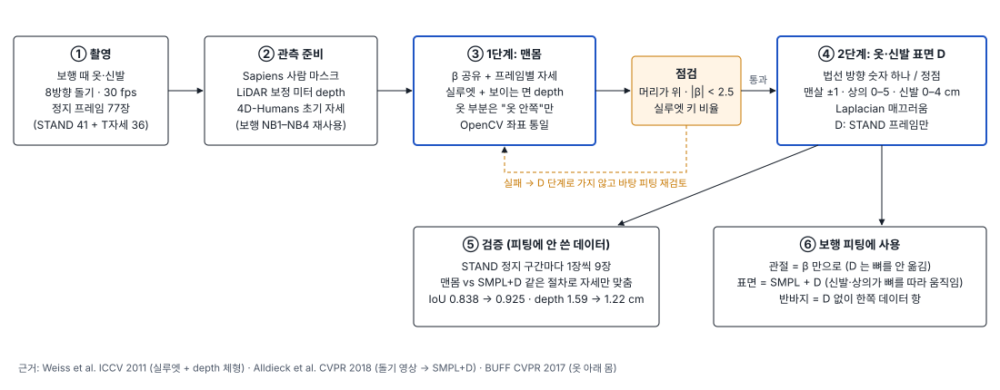
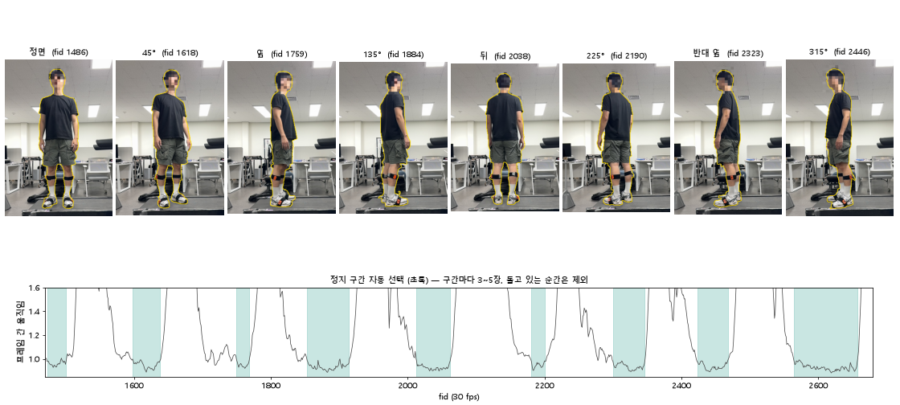
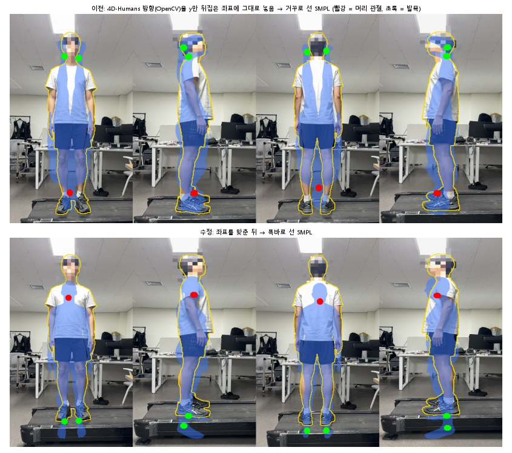
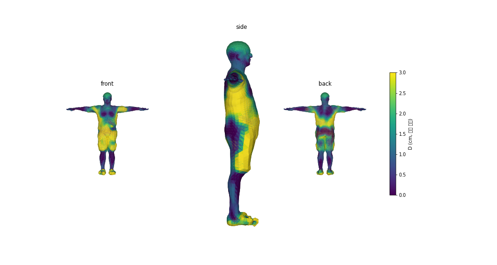
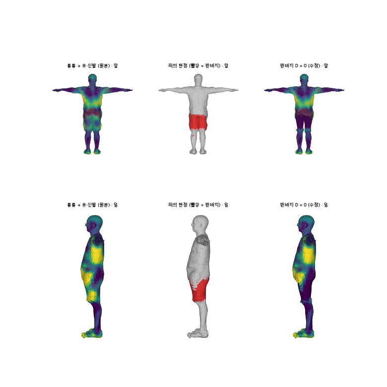
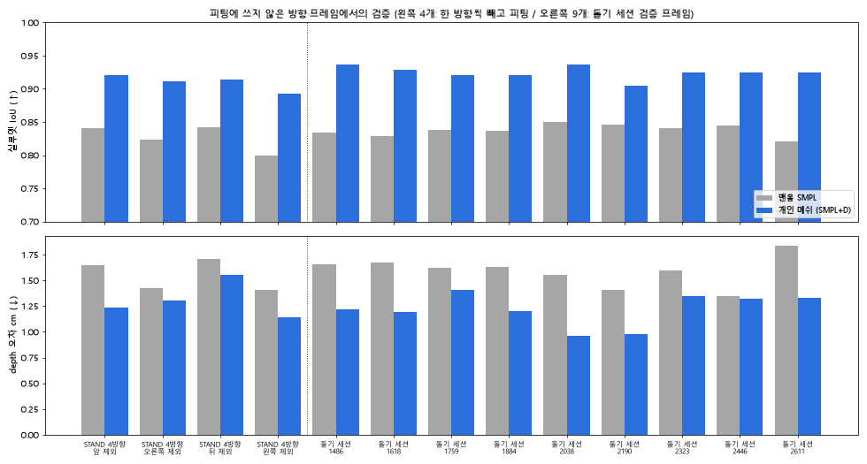
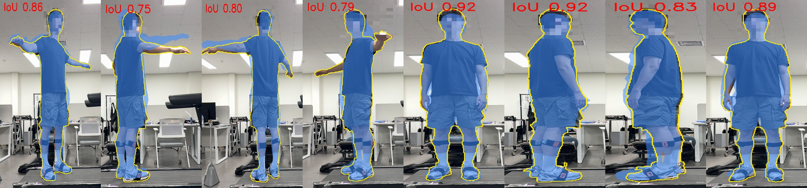
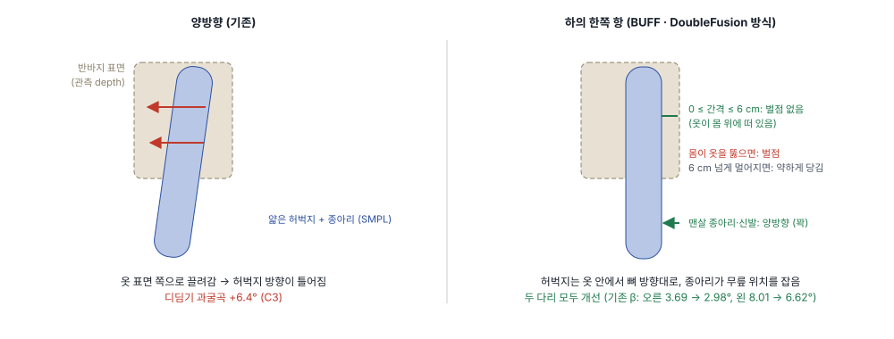
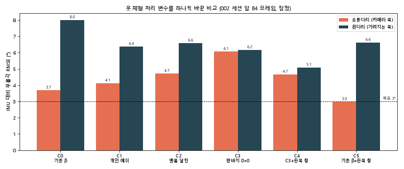

# 0 · 개인 메쉬 (체형 + 옷·신발 표면)

보행 영상 하나로 관절각을 얻으려면 **몸 모델이 그 사람과 같은 모양**이어야 합니다. 이 단계는 보행 때와 **같은 옷·신발**로 한 바퀴 돈 영상에서, 체형(SMPL β)과 옷·신발 표면(정점별 변위 D)을 가진 **개인 메쉬(SMPL+D)** 를 만듭니다. 보행 피팅은 이 메쉬를 고정해 쓰고, 프레임마다 자세만 움직입니다.

## 목차
1. [왜 필요한가](#1-왜-필요한가)
2. [촬영과 프레임 선택](#2-촬영과-프레임-선택)
3. [이전 시도에서 배운 것](#3-이전-시도에서-배운-것)
4. [방법](#4-방법)
5. [옷 영역 판정](#5-옷-영역-판정)
6. [검증](#6-검증)
7. [보행 피팅에 쓰는 법](#7-보행-피팅에-쓰는-법)
8. [옷 처리: 변수를 하나씩 떼어 본 과정](#8-옷-처리-변수를-하나씩-떼어-본-과정)
9. [실행](#9-실행)

---

## 1. 왜 필요한가

| 문제 | 영향 |
|---|---|
| 프레임마다 학습 기반 추정(4D-Humans)으로 체형을 정하면 다리 길이가 출렁임 | 같은 사람인데 매 프레임 뼈 길이가 달라짐 |
| 맨몸 SMPL 을 **옷 입은 depth 표면** 에 맞추면 뼈가 옷 쪽으로 끌려감 | 헐렁한 반바지·신발이 무릎·발목 방향을 틀어지게 함 |

그래서 체형은 한 번 정해 고정하고, 옷·신발 모양은 **잴 수 있는 만큼** 메쉬에 넣습니다. 걸을 때 모양이 계속 바뀌는 옷(헐렁한 반바지)은 따로 다룹니다 ([7](#7-보행-피팅에-쓰는-법), [8](#8-옷-처리-변수를-하나씩-떼어-본-과정)).

## 2. 촬영과 프레임 선택

- 보행 촬영과 **같은 날, 같은 옷·신발**. 카메라 고정, 사람이 약 45° 씩 돌며 8방향에서 잠깐씩 멈춤 (팔 내린 정자세 + 팔 벌린 T자세 각 한 바퀴), 30 fps.
- 돌고 있는 순간은 흔들림과 **RGB·LiDAR 촬영 시점 차이** 때문에 마스크와 depth 가 어긋남 → 프레임 간 RGB 차이로 **정지 구간만 자동 선택** ([`select_still_frames.py`](personal_mesh/select_still_frames.py)). 정자세 41장 + T자세 36장 = 77장.
- 고른 프레임은 보행 파이프라인 NB1 ~ NB4 (Sapiens 마스크, LiDAR 보정 미터 depth, 4D-Humans 초기 자세) 를 그대로 거칩니다.

## 3. 이전 시도에서 배운 것

이 단계는 여러 번 다시 만들었습니다. 이전 버전들의 실패가 지금 설계의 근거입니다 (자세한 표: [DECISIONS D2](../docs/DECISIONS_2026-10_personal_mesh.md)).

| 이전 시도 | 무엇이 잘못됐나 | 지금 설계에 반영 |
|---|---|---|
| 정자세 4방향 피팅 (II-8 → II-13) | 4D-Humans 몸 방향(OpenCV, y 아래)을 y 만 뒤집은 관측 좌표에 **변환 없이** 넣어 SMPL 이 거꾸로 선 채 피팅됨 (방향 176 – 181°). 방향 변화 한도 11° 때문에 끝까지 못 고침 | 처음부터 끝까지 **OpenCV 좌표 하나**로 통일, 피팅 전·후 "머리가 발목보다 위" 점검 |
| 같은 시도 | 키 맞추기 이후 β 변화 < 0.03 → 체형이 사실상 "평균 + 키". 데이터 항이 depth z 하나라 메쉬가 사람에게서 벗어나도 손실이 줄어듦 (오른쪽 뷰 IoU 0.66 → 0.20) | **실루엣을 주 항으로**, depth 는 보이는 면끼리 양방향 |
| 같은 시도 | 키(입력값)를 "1.808 m 일치" 로 보고 | 키는 약한 사전값으로만, **피팅에 안 쓴 데이터로 검증** |
| SparseFusion 재현 (조각 융합 + Poisson) | 수치는 좋아졌지만 메쉬가 사람 모양이 아님 (키 2.15 – 2.24 m) | 자유 메쉬 대신 **SMPL 위의 법선 방향 변위만** (구조상 사람 모양 유지) |
| 자유 3D 변위 SMPL+D | 바탕 몸이 어긋난 걸 D 가 메움 (피부 D 6 cm > 옷 D) | **바탕 피팅이 점검을 통과해야만** D 단계 진행, 영역별 범위 |

## 4. 방법

**1단계 · 맨몸** ([`fit_personal.py`](personal_mesh/fit_personal.py))
- 모든 프레임이 **β 하나를 공유**, 자세·위치는 프레임마다. 초기 위치는 몸통 정점을 depth 중앙값 + 몸 반두께에 맞춤 (4D-Humans 가 T자세 팔 방향을 틀려도 안정).
- 손실 (프레임마다 자기 카메라에서 계산, 합친 점군 안 씀):

| 항 | 내용 |
|---|---|
| 실루엣 바깥 | 투영한 정점이 마스크 밖이면 벌점 (거리 변환 지도) |
| 실루엣 채우기 | 마스크 점 → 가장 가까운 정점. 맨살은 꽉, 머리카락·신발은 3 cm 여유, **옷은 채우지 않아도 됨 (옷 아래 몸)** |
| depth | 카메라를 향한 정점만, 5 cm truncated. 맨살은 양방향, 옷은 "몸이 옷보다 앞이면 벌점" 한쪽만 |
| 관측 점 → 메쉬 | 맨살 정점이 가장 가까운 점만 |
| 사전값 | 자세는 4D-Humans 쪽으로, β 는 성분별 가중 (키 성분 느슨), 키 약하게 |

- **점검**: 모든 프레임에서 머리가 발목보다 위, |β| < 2.5 (이전 시도에서 β 가 ±3 에 붙던 실패 방지), 실루엣 키 비율 0.90 – 1.03.

**2단계 · 옷·신발 표면 D**
- 정점마다 **법선 방향 숫자 하나** (옆으로 미끄러지지 않음). 범위: 맨살 ±1 cm, 상의 0 – 5 cm, 신발 0 – 4 cm, 머리 0 – 2 cm. Laplacian 매끄러움.
- **정자세 프레임만** 사용 (팔을 들면 티셔츠가 올라가 모양이 달라짐. 보행 때 팔 모양은 정자세에 가까움). T자세는 체형 β 에만.
- 관절은 β 로만 계산하고 D 는 표면에만 → D 가 뼈 위치를 바꾸지 않음.

## 5. 옷 영역 판정

SMPL 부위 경계는 실제 옷 경계와 다릅니다 (예: SMPL 의 골반 부위는 티셔츠 아랫단까지 포함). 그래서 **피팅된 메쉬를 Sapiens 부위 라벨(상의·하의) 사진에 투영해 정점마다 투표**합니다 ([`garment_labels.py`](personal_mesh/garment_labels.py)). 가려진 정점은 depth 로 걸러 내고, 반바지 위에 손을 올린 프레임 때문에 손이 하의로 잡히지 않도록 하의는 골반·다리 부위 안에서만 인정합니다.

## 6. 검증

피팅에 **쓰지 않은** 방향·프레임에서 맨몸 SMPL 과 SMPL+D 를 같은 절차로 맞춰 비교했습니다 (체형 고정, 그 프레임의 자세·위치만 맞춤).

| 검증 | 맨몸 SMPL | SMPL+D |
|---|---|---|
| 정자세 4방향, 한 방향씩 빼고 피팅 → 뺀 방향 (4회) | IoU 0.80 – 0.84 · depth 1.41 – 1.71 cm | **IoU 0.89 – 0.92 · depth 1.14 – 1.55 cm** |
| 돌기 세션, 정지 구간마다 1장씩 뺀 9장 (8방향) | IoU 0.838 · depth 1.59 cm | **IoU 0.925 · depth 1.22 cm** (9장 모두 향상) |

한계: 4D-Humans 가 T자세 팔 방향을 틀린 일부 프레임은 자세 최적화가 끝까지 바로잡지 못함 (IoU 0.42 – 0.75). 이 프레임들은 체형 β 에만 쓰이고 D 에는 쓰이지 않습니다. 다리 길이 줄자 실측은 아직 없습니다.

## 7. 보행 피팅에 쓰는 법

- [`pipeline/scripts/personal_smpl.py`](../pipeline/scripts/personal_smpl.py): smplx SMPL 과 같은 사용법. **관절은 β 만으로**, 정점에만 D 를 더해 같은 LBS 로 자세를 입힘. 단위 시험: D = 0 이면 smplx SMPL 과 정점·관절 차이 0.
- **헐렁한 반바지는 D 로 넣지 않습니다.** 서 있을 때 만든 반바지 모양은 걸을 때와 다르기 때문입니다. 대신 보행 피팅의 데이터 항에서 반바지 정점은 **"몸이 옷 밖으로 나오면 벌점" 한쪽만** 적용합니다 ([`leg_data_term.py`](../pipeline/scripts/leg_data_term.py), BUFF · DoubleFusion 방식).

## 8. 옷 처리: 변수를 하나씩 떼어 본 과정

개인 메쉬를 보행에 처음 넣었을 때 **가려지는 왼다리는 좋아졌지만 카메라 쪽 오른다리는 나빠졌습니다.** 원인을 찾으려고 한 번에 하나씩 바꿔 IMU 무릎각과 비교했습니다 (002 세션 앞 84 프레임, 보행 약 2 주기, 잠정).

| 단계 | 바꾼 것 | 확인한 것 |
|---|---|---|
| C0 → C1 | 기존 β → 개인 메쉬 (옷·신발 D 포함) | 왼다리 8.0 → 6.4°, 오른다리 3.7 → 4.1° |
| C1 → C2 | 맨몸만 날씬하게 (허리 99 → 95 cm) | 오른다리 더 나빠짐 → **"통통한 체형 탓" 가설 기각**. 옷 입힌 겉면은 데이터에 맞춰져 거의 같음 |
| C1 → C3 | 반바지 D 만 0 | 오른 디딤기 **과굴곡 +6.4°**: 얇은 허벅지가 반바지 표면으로 끌려감 → 반바지 모양을 넣어도 빼도 문제 |
| C3 → C4 | 반바지 정점에 한쪽 데이터 항 | 왼다리 최고 5.1°, 오른 디딤기 과굴곡 +6.4 → +4.2° |
| C0 → C5 | 기존 β 에 한쪽 항만 | 오른 3.7 → **3.0°**, 왼 8.0 → 6.6° → **한쪽 항은 두 다리 모두 개선**, 오른다리 악화는 개인 메쉬 쪽 요인 |

남은 질문 — 개인 메쉬 중 **어느 요소(β / 신발 D / 상의 D)** 가 왼다리를 돕고 오른다리를 해치는가 — 는 β 2 × D 4 × 데이터 항 2 = **16 조합 완전 요인 실험** 으로 한 번에 정리 중입니다 ([`NB_EXPERIMENTS`](../pipeline/notebooks/NB_EXPERIMENTS.ipynb)). 선택 기준(두 다리 RMSE 평균 최소)은 실험 전에 고정했고, 최선 조합은 250 프레임으로 다시 확인합니다.

## 9. 실행

| 단계 | 어디서 | 무엇을 |
|---|---|---|
| 정지 프레임 선택 | 로컬 | `python personal_mesh/select_still_frames.py RAW.r3d 1470 2680` → fid 목록 |
| 추출 | 로컬 | `pipeline/scripts/extract_session.py --fids <목록>` (WALK_SESSION=돌기 세션) |
| 관측 준비 | Colab | `NB_RUN_ALL` 의 NB2 ~ NB4 (START_AT 2, END_AT 4) |
| 개인 메쉬 | Colab | [`NB_PERSONAL`](personal_mesh/NB_PERSONAL.ipynb) → `assets/personal_mesh_*.npz` |
| 옷 영역 판정 | 로컬 | `python personal_mesh/garment_labels.py SESSION OUT 800 1475 1600 2425` |
| 보행에 적용 | Colab | `NB_RUN_ALL` 에서 `PERSONAL_MESH`, `CLOTH_ONESIDED` 지정 |

이전 정자세 4방향 코드는 [`legacy_stand4/`](legacy_stand4) 에 기록용으로 남겨 두었습니다 (좌표 버그 포함, 재사용하지 말 것).
